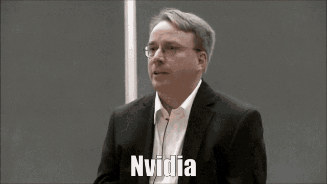

살면서 인터넷 생활 하다보면 한명씩 짜증나는 사람 있잖아요.

음... 솔직히 차단 한 사람도 그렇고 차단 당한 사람도 그렇고  
언급 안하는게 좋은 것 같아요.

만약에 당신이 어떠한 방법에 의해서 누군가에게 차단 당했다는걸 알게되었다면  
공개적인 곳에서 그거에 대해 언급하는건... 좀 되게 별로에요.

솔직히 말하자면 좀 찐따같아요.

지금부터는 디스코드를 기준으로 이야기 하는거에요.

차단 당했고 그거에 대해 불만이라면 공개적인 장소보다는 비공개적인 장소에서 얘기하는게 좋은 것 같아요.

이를테면 친구에게 DM이나 단톡으로  

> 내가 누구한테 차단당했는데 왜 당했을까?  

하며 고민을 털어놓는다거나,

차단을 풀어달라고 말하더라도  
(물론 풀어달라고 부탁하는 것 자체가 되게 짜증나는 일이지만...)  
공통된 서버에서 그 사람을 언급하면서

> `@내-닉네임` 왜 차단하셨나요? 풀어주세요.

같은 식으로 말하는것 보다는  
부계정을 써서 DM으로

> 차단하셨던데, 왜 차단하셨는지 알수 있을까요? 불편한 점 있으셨다면 죄송합니다.

와 같은 식으로요.

물론 애초에 차단한 것에 대해 직접 이의를 거는것 자체가 좀 짜증나죠.

그냥 차단 당했으면 닥치고 있으세요.

당연히 반대의 경우에도 마찬가지입니다. 내가 누군가를 차단했는데, 은근슬적 메시지 몇개 위에 "차단된 메시지"가 같이 보이게 스크린샷을 찍어서 올린다던가,  
공개 서버에서 

> `@차단한-사람` 이 사람 짜증나서 차단함

같이 말한다거나.

이거도 좀... 찐따같아요.

하지마세요.

그냥 차단했으면 닥치고 계세요.  
차단 당했으면 닥치고 계세요.

